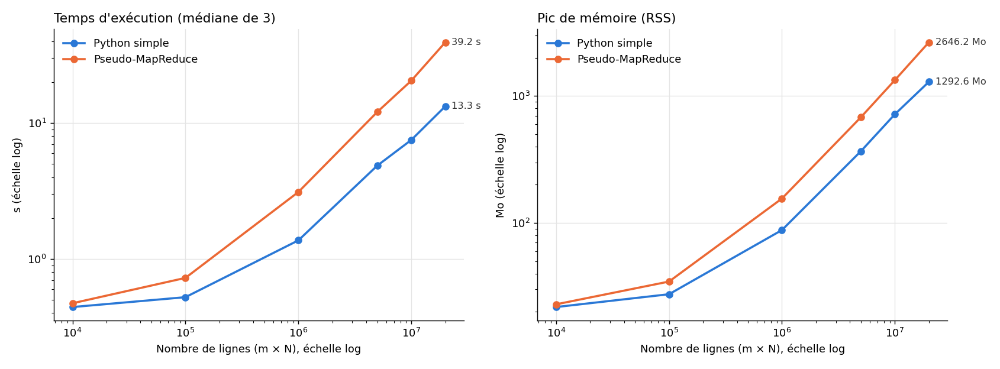

# Hadoop MapReduce — comptage de mots : 3 méthodes comparées

TP du cours *Fondements et Application de Big Data* (13/10/2026) : implémenter, tester et comparer trois méthodes
de comptage des occurrences de mots sur des fichiers de tailles croissantes.

| # | Méthode | Fichier |
|---|---|---|
| 1 | Python séquentiel simple (dictionnaire) | `src/wordcount_simple.py` |
| 2 | Pseudo-MapReduce Python (map → shuffle → reduce en local) | `src/wordcount_mapreduce.py` |
| 3 | Hadoop MapReduce : WordCount Java + Hadoop Streaming (`hadoop/mapper.py`, `hadoop/reducer.py`) | `hadoop/`, `src/hadoop_runner.py` |

**Le rendu est le notebook [`notebook_comptage_mots.ipynb`](notebook_comptage_mots.ipynb)** : explications, code, tests,
comparaisons et conclusion.

## Contenu

```
src/generer_fichier.py     génération d'un fichier de N lignes (1 mot/ligne, avec répétition) puis duplication m fois
src/wordcount_simple.py    méthode 1
src/wordcount_mapreduce.py méthode 2
src/hadoop_runner.py       méthode 3 : pilote le cluster Hadoop (HDFS + jobs) via docker compose
src/benchmark.py           mesure temps + mémoire pour plusieurs valeurs de m, vérifie que les résultats sont identiques
hadoop/docker-compose.yml  cluster pseudo-distribué apache/hadoop:3.4.1 (namenode, datanode, resourcemanager, nodemanager)
hadoop/mapper.py, reducer.py  job Hadoop Streaming en Python
tests/test_wordcount.py    tests pytest
results/                   résultats du benchmark (CSV) et graphique
```

## Utilisation

```bash
pip install -r requirements.txt
python src/generer_fichier.py --n 10000 --m 1 10 100 1000   # fichiers dans data/
python src/wordcount_simple.py data/mots_N10000_m100.txt
python src/wordcount_mapreduce.py data/mots_N10000_m100.txt
python -m pytest -v tests
python src/benchmark.py --sans-hadoop                       # méthodes Python seulement
python src/benchmark.py                                     # + Hadoop (Docker Desktop démarré)
```

Hadoop à la main :

```bash
docker compose -f hadoop/docker-compose.yml up -d
docker compose -f hadoop/docker-compose.yml exec namenode bash
hdfs dfs -mkdir -p /input/mots && hdfs dfs -put /data/mots_N10000_m100.txt /input/mots/
hadoop jar /opt/hadoop/share/hadoop/mapreduce/hadoop-mapreduce-examples-3.4.1.jar wordcount /input/mots /output/java
hdfs dfs -cat /output/java/part-r-00000
```

Interfaces web : HDFS http://localhost:9870, YARN http://localhost:8088.

## Résultats (N = 10 000, médiane de 3 exécutions)

| m | lignes | taille (Mo) | Python simple (s) | Pseudo-MapReduce (s) | ratio | mémoire simple (Mo) | mémoire pseudo-MR (Mo) |
|---:|---:|---:|---:|---:|---:|---:|---:|
| 1 | 10 000 | 0.06 | 0.44 | 0.47 | 1.07 | 21.8 | 22.9 |
| 10 | 100 000 | 0.61 | 0.52 | 0.73 | 1.39 | 27.5 | 34.6 |
| 100 | 1 000 000 | 6.11 | 1.37 | 3.11 | 2.27 | 88.0 | 155.8 |
| 500 | 5 000 000 | 30.54 | 4.86 | 12.07 | 2.48 | 367.5 | 680.4 |
| 1000 | 10 000 000 | 61.08 | 7.51 | 20.51 | 2.73 | 717.7 | 1333.9 |
| 2000 | 20 000 000 | 122.16 | 13.27 | 39.24 | 2.96 | 1292.6 | 2646.2 |



> Les temps Hadoop n'ont pas été mesurés sur ce poste : Docker Desktop n'a pas pu démarrer au moment du TP.
> Le document de cours indique ~12 s pour un job WordCount sur un tout petit fichier, ce qui correspond à la latence fixe de
> démarrage d'un job YARN. Lancer `python src/benchmark.py` avec Docker démarré ajoute ces mesures.

**Conclusion courte :** sur une seule machine, le Python simple est le plus rapide ; le pseudo-MapReduce est environ 3 fois plus lent
et utilise environ 2 fois plus de mémoire (paires intermédiaires matérialisées) ; Hadoop a une latence fixe d'une dizaine de secondes
et n'est rentable que pour des volumes qui dépassent la mémoire d'une machine, répartis sur un vrai cluster.
